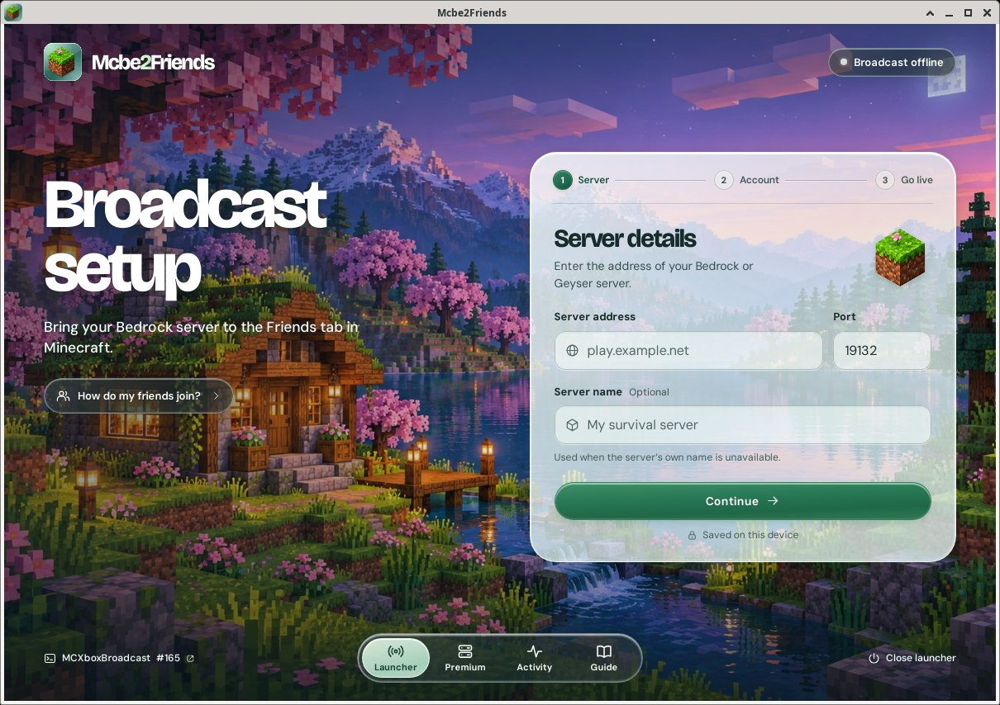
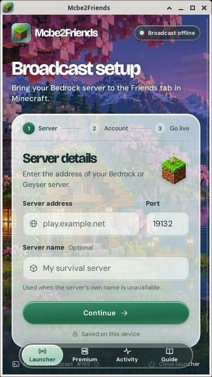

# Mcbe2Friends

Put your Bedrock or Geyser server in Minecraft’s **Friends** tab. Mcbe2Friends sets up MCXboxBroadcast and Java for you, then remembers your server for next time.

[Visit the project site](https://ll2rawll.github.io/MCBE2Friends/) · [Full customer walkthrough](https://ll2rawll.github.io/MCBE2Friends/#walkthrough)

  
  

## Download

[Windows x64](https://github.com/ll2Rawll/MCBE2Friends/releases/download/v1.4.0/Mcbe2Friends-Windows-x64.zip) · [macOS, Intel and Apple silicon](https://github.com/ll2Rawll/MCBE2Friends/releases/download/v1.4.0/Mcbe2Friends-macOS.zip) · [Linux x64](https://github.com/ll2Rawll/MCBE2Friends/releases/download/v1.4.0/Mcbe2Friends-Linux-x64.tar.gz) · [Linux ARM64](https://github.com/ll2Rawll/MCBE2Friends/releases/download/v1.4.0/Mcbe2Friends-Linux-ARM64.tar.gz)

## Premium self-hosting

Open **Premium** in the launcher to check your PC. One **$15 USD** installation key includes Java and Bedrock hosting. Choose **Java Edition → Create a server** for Vanilla, Paper with plugins, or Paper with Geyser so Bedrock friends can join. The launcher picks settings for your hardware and manages worlds, backups, players, and the console. Java runs on all four desktop downloads. Native Bedrock runs on Windows and Linux x64.

[Purchase via Discord](https://discord.gg/X5adbkPq) · [Premium hosting guide](docs/premium-hosting.md)

## Play with friends

1. Extract and open **Mcbe2Friends**. Enter your running server’s Bedrock address and port (usually `19132`).
2. Choose **Connect & start**. Enter the code on Microsoft’s sign-in page using the Xbox account your friends will add.
3. When you see **Broadcast live**, have your friends add that gamertag. Once their requests are accepted, they can join from **Play → Friends** in Minecraft Bedrock.

Close the launcher while friends play. Keep the PC awake. After a restart, each service you left on resumes at your next sign-in. **Stop broadcast** and **Stop server** turn them off independently. [Set up unattended startup before sign-in](docs/guide.md#unattended-startup)

[Setup and troubleshooting guide](docs/guide.md) · [MCXboxBroadcast project](https://github.com/MCXboxBroadcast/Broadcaster)
