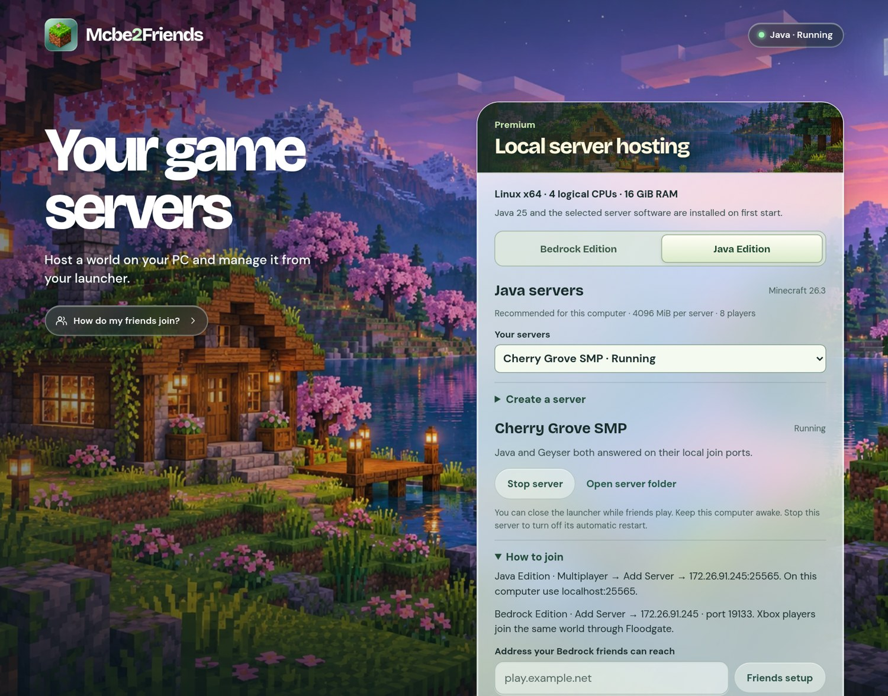
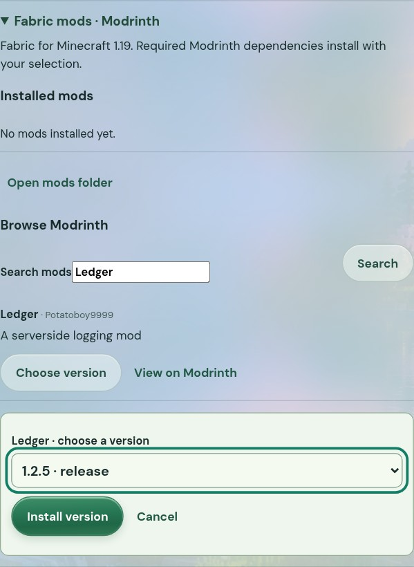
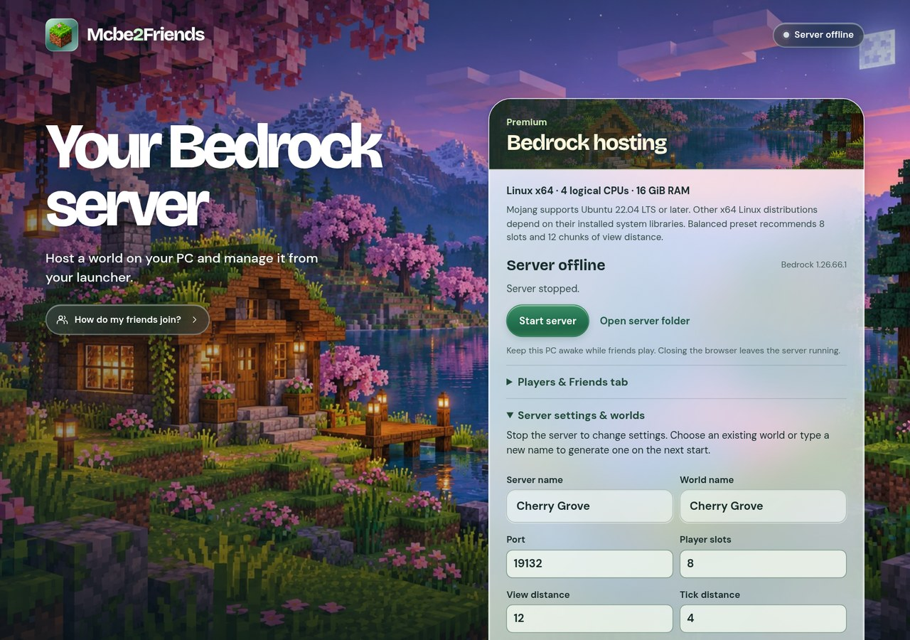

# Premium self-hosting

Premium is a one-time **$15 USD** unlock for the hosting panel on one launcher installation. The server runs on the buyer’s PC. The same purchase includes Java and Bedrock hosting. Existing Premium keys work with Java after updating. Broadcasting an existing server through the Friends tab stays free.

## Check your PC first

Open **Premium** in Mcbe2Friends. The panel shows the operating system, available logical CPUs, memory, and a suggested configuration before purchase. Native Bedrock hosting targets Windows x64 and Ubuntu 22.04 LTS or newer on x64. Other x64 Linux distributions can work if their runtime libraries are compatible. Java hosting supports Windows x64, macOS on Intel and Apple silicon, and Linux on x64 and ARM64. Allow at least 4 GB of system RAM.

| Bedrock preset | Hardware | Player slots | View / tick distance |
| --- | --- | --- | --- |
| Small | Below the Balanced thresholds | 4 | 8 / 4 chunks |
| Balanced | At least 4 logical CPUs and about 8 GiB RAM | 8 | 12 / 4 chunks |
| Large | At least 8 logical CPUs and about 16 GiB RAM | 12 | 16 / 6 chunks |

These are starting settings. The launcher leaves CPU capacity for the operating system and respects Linux container limits when available. Reduce the view distance or player count if a heavily modified world runs slowly.

## Activate Premium

Copy **Your PC code** and open **Get Premium on Discord**. Send the seller the code, arrange payment, and paste the key they return into **Activation key**. Select the edition you want to host.

## Host Java Edition

Open **Premium → Java Edition → Create a server**, give it a name, choose a Minecraft release, then pick the software. Vanilla and Fabric cover all 29 stable releases from **1.19 through 26.3**. Existing Java profiles keep their original **26.3** world. Create a separate profile when you want to play a different version.

| Choice | Who can join | What the launcher installs |
| --- | --- | --- |
| Vanilla Java | Java Edition players | Mojang’s official Java server |
| Fabric | Java Edition players, with matching client mods when required | Official Fabric Loader 0.20.1 and a standard mods folder |
| Paper | Java Edition players | Paper with a standard plugins folder |
| Paper + Geyser | Java and Bedrock players in the same world | Paper, Geyser, Floodgate, and ViaVersion for older supported releases |

Accept the Minecraft EULA and choose **Create & start**. Choose **Create only** to adjust settings first. The launcher verifies downloads and supplies Java 17 through Minecraft 1.20.4, Java 21 from 1.20.5 through 1.21.11, and Java 25 for 26.x. The picker shows Paper where the project published a build, labels experimental builds, and offers managed Geyser on Paper 1.20.5 and newer. Paper and Geyser may fetch additional upstream resources on first start. [Minecraft EULA](https://www.minecraft.net/eula) · [Paper](https://papermc.io/software/paper) · [Geyser and Floodgate](https://geysermc.org/wiki/geyser/)

- **Join.** Java players use **Multiplayer → Add Server** and the displayed address with its TCP port, initially 25565. On the host PC, use `localhost`. Bedrock players use the Geyser address and port under **How to join**. They sign in with Xbox. Java players use their Java accounts.
- **Play over the internet.** Forward the displayed Java TCP port to the host computer. For cross-play, also forward Geyser’s displayed port for **TCP and UDP**. On a PC with native Bedrock support the launcher reserves its configured port and normally suggests 19133 for Geyser. **Friends setup** fills in Geyser’s address and port in the free Xbox broadcaster.
- **Tune or switch cross-play.** Stop the profile, open **Settings & cross-play**, and change its memory, player slots, distances, game mode, difficulty, or selected world. On a compatible Paper profile, switch Geyser on or off and save. Start the same profile to continue playing its world. Java keeps online account authentication enabled. Cross-play allows Bedrock chat without a Java chat signature. Switching it off restores your previous Java chat-signing setting.
- **Manage files.** Import trusted Paper plugin JARs, enable or disable them, or remove them while stopped. Back up a world to ZIP, import a Java world ZIP, or restore a backup to a fresh folder. Select that folder in settings and start the server. Players and console commands are available while the game is running.
- **Run multiple servers.** Each profile owns its ports, memory allowance, startup choice, and files in `hosting/java/servers/<id>`. **Open server folder** opens the real `server.properties`, `worlds`, and the engine’s `plugins` or `mods` folder. Use **Reload from server files** after making manual edits. World backups live in the profile’s `backups` folder. A world ZIP includes dimensions and player data. Copy the profile folder while stopped to migrate plugins and settings as well.
- **Close or restart.** Close the panel while the PC stays awake. The worker verifies Premium and restores each enabled server at your next sign-in. **Stop server** turns off automatic restart for that profile. [Startup before sign-in](guide.md#unattended-startup)

## Install Fabric mods from Modrinth

1. Choose **Fabric → Create only**. For an existing Fabric server, select it and stop it before changing mods.
2. Open **Fabric mods · Modrinth**. Search by project name, select **Choose version**, then **Install version**. The launcher checks the exact Minecraft release, selects files for dedicated Fabric servers, verifies Modrinth’s SHA-512 checksums, and installs required dependencies.
3. Check **Installed mods**, accept the Minecraft EULA, and start the server. If a project also requires a client mod, players install its matching release in their own Fabric client.
4. To change a mod, stop the server and use **Versions**, **Disable**, **Enable**, or **Remove**. Dependencies stay visible. Make changes to a dependent mod before removing a file it needs. **Open mods folder** opens the standard folder for files you manage yourself.

[Fabric Loader](https://fabricmc.net/) · [Modrinth server mods](https://modrinth.com/mods)

## Host Bedrock Edition

1. Review the Minecraft terms and choose **Install & start server**. The launcher downloads the pinned Bedrock server directly from Minecraft, verifies its size and SHA-256, applies your preset, and checks the selected world through Bedrock’s local NetherNet signaling endpoint. Later launches reuse the installation and worlds.
2. Under **Players & Friends tab**, enter each player’s Xbox gamertag and click **Allow**. The new server starts with Microsoft online authentication and the allowlist enabled.
3. Players on your LAN can enter the local address and port in Bedrock. For the Friends tab, enter a reachable address under **Players & Friends tab**, choose **Friends setup**, and complete the normal Xbox broadcast setup.

For internet players, the included NetherNet server uses TCP signaling and UDP game traffic. Allow and forward the configured port for **both TCP and UDP** to the host PC, typically 19132. Configure those rules in your firewall and router. A public hostname or IP alone cannot provide inbound connectivity behind carrier-grade NAT. Keep the PC awake. **Close launcher** leaves the world running. After a restart, Bedrock verifies Premium and starts your saved world at the next sign-in. **Stop server** saves the world and turns off automatic restart for Bedrock. [Unattended startup before sign-in](guide.md#unattended-startup)

[Purchase on Discord](https://discord.gg/X5adbkPq) · [Official server download and requirements](https://www.minecraft.net/en-us/download/server/bedrock) · [Minecraft EULA](https://www.minecraft.net/eula)

## Manage Bedrock worlds and add-ons

- **Server settings & worlds** edits standard server.properties. Change the port, slots, mode, difficulty, allowlist, cheats, view distance, tick distance, or threads. Select an existing world or enter a new name, save, and start. Unknown properties and comments are preserved. **Reload from server files** picks up manual edits.
- **Add-ons** imports behavior and resource packs from .mcpack, .mcaddon, or ZIP files up to 128 MiB. Enable each required pack for the selected world. Stop the server before editing. Disable a pack in every world before removing it. To replace an imported pack, remove the old version and import the new one. Manually installed packs and packs bundled inside the selected world also appear in the library.
- **World imports & backups** creates a .mcworld backup of a stopped world. For a restore, use an unused folder with the world’s original saved name so the launcher recognizes it when it starts. If that folder already exists, stop the server and use **Open server folder** to rename the old folder inside `worlds` and keep both copies. Import the .mcworld or ZIP (up to 512 MiB), select the restored world in settings, and start it. A backup includes the world and its pack references. Copy the separate behavior_packs and resource_packs folders when migrating add-ons.
- **Server console** displays recent output and accepts Bedrock commands such as `list`, `say Welcome!`, and `op "Xbox Gamertag"`. Use **Players & Friends tab** to add or remove allowlisted players without typing a command.
- **Open server folder** exposes normal world, allowlist, permissions, pack, and configuration files. The server is stored under `hosting/server` in the launcher's data folder. Backups live in `hosting/backups`. Stop Bedrock before making manual changes or copying its database.

The background worker checks the signed purchase approval at activation, at startup, and every five minutes while hosting. A confirmed withdrawal saves and stops an active server. During a temporary registry outage, the launcher can keep hosting for up to 30 minutes from its last successful check. Keep the PC connected while hosting.

Your PC code is specific to the operating system installation and the launcher's local installation file. The registry receives a purchase hash. The operating system identifier stays on your PC. Back up your worlds and the private `hosting/installation.txt` and `hosting/premium-key.txt` files before reinstalling. Contact the owner for a transfer if you change PCs, reinstall the operating system, or already purchased a key for an older version. [Premium support](https://discord.gg/X5adbkPq)
